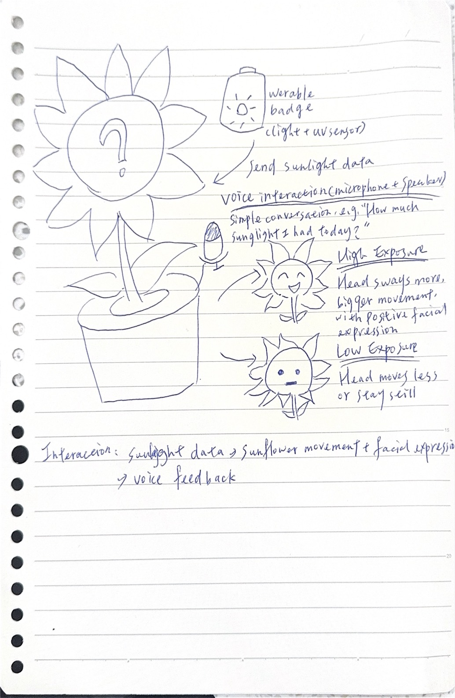
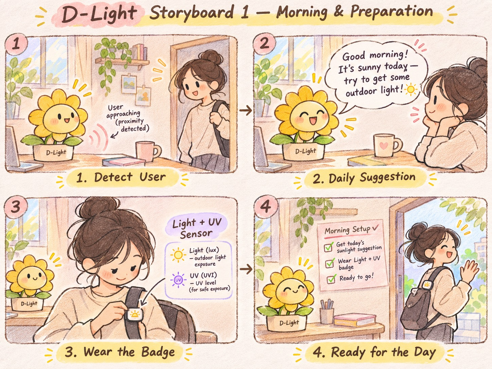
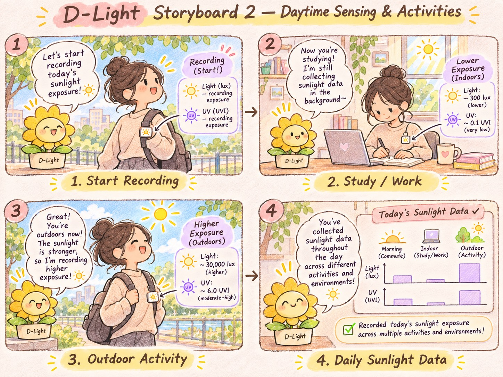
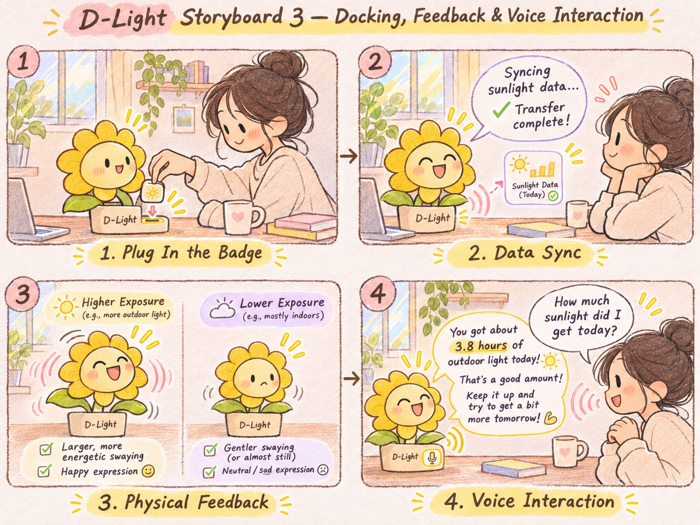
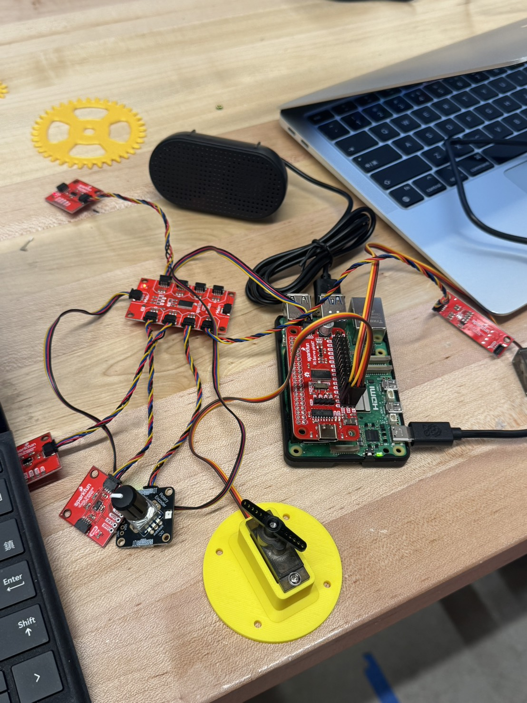
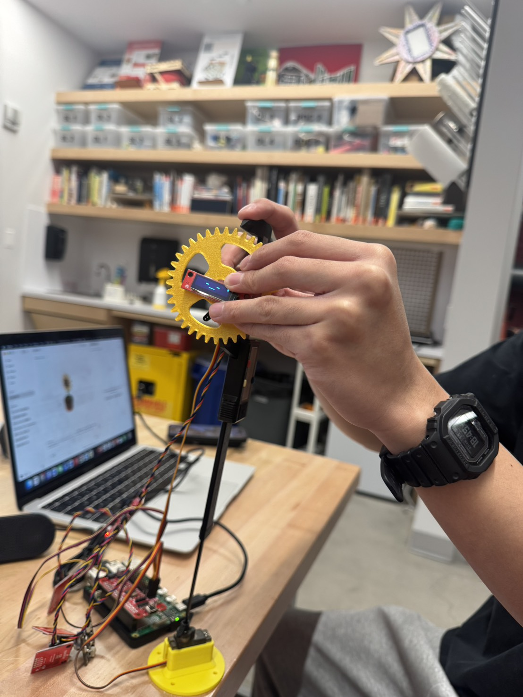
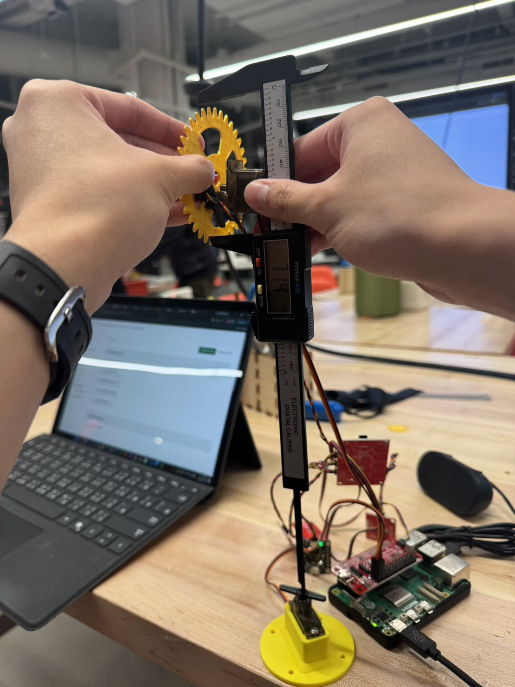
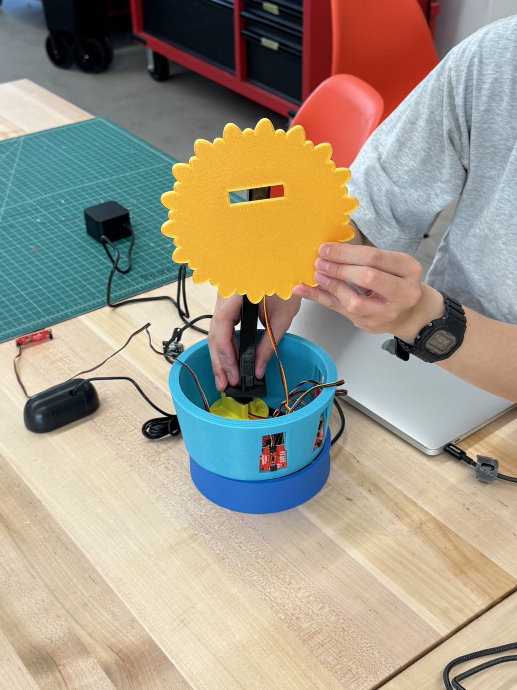

# D-Light: A Sunflower Powered by Your Sunlight

**Course:** Interactive Device Design — Fall 2026

**Team:** Jiesen Huang, Serena Tsai, Yuge Xu, Youzhu Jin, Zijii Zhang, and Terence Zhang

**Project Description:** D-Light is an interactive sunflower that responds to the sunlight its user collects throughout the day. By combining a wearable light-sensing badge with an expressive robotic sunflower, D-Light transforms everyday light exposure into a tangible and playful experience.

---

## 1. Project Selection: Topic, Motivation, and User Experience

### 1.1 The Big Idea

D-Light is a sunflower that lives on your desk and "eats" the sunlight you collect each day.

During the day, the user wears a small badge that measures light and UV exposure. When the user returns home and docks the badge, the sunflower responds to the collected data through physical movement, facial expressions, and feedback.

The sunflower sways its head with larger, more energetic movements when the user has collected sufficient sunlight, while its movements become smaller and gentler—or stop entirely—when sunlight exposure is low.

By taking care of the sunflower, users are encouraged to become more mindful of their own daily routines.

### 1.2 Motivation

During winter, shorter daylight hours and indoor lifestyles can reduce people's opportunities for natural light exposure.

Light exposure plays an important role in regulating circadian rhythms, sleep, and overall well-being. However, people often have limited awareness of how much natural light they encounter throughout the day.

Most tracking tools present health-related data through charts, numbers, and notifications. D-Light explores a different approach by making environmental data visible through the behavior of a physical companion.

**Design Question:**

How might we turn daily sunlight exposure into a playful, emotionally engaging interaction that encourages people to reflect on their well-being?

### 1.3 Target Users

Our primary target users include:

- Students who spend long hours studying indoors.
- Office workers with limited opportunities for outdoor activities.
- People experiencing shorter daylight hours during winter.
- Individuals interested in playful approaches to everyday wellness awareness.

### 1.4 User Experience

### Morning — Greeting and Preparation

When the user approaches D-Light in the morning, the sunflower detects their presence and turns toward them. Through its built-in microphone and speaker, D-Light greets the user and can provide a brief weather-based suggestion about opportunities to spend time outdoors.

Before leaving, the user puts on the wearable sunlight badge to begin collecting their daily light exposure.

### Daytime — Collecting Sunlight

Throughout the day, the user wears the badge during their normal activities. The badge periodically measures ambient light and UV exposure without requiring the user to interact with it.

The collected data represents the user's daily light exposure and will later determine how the sunflower responds.

### Returning Home — Feeding the Sunflower

When the user returns home, they connect the badge to D-Light through its magnetic USB-C docking connection, transferring the collected sunlight data to the Raspberry Pi.

The sunflower responds through movements that reflect the user's sunlight exposure:

Sufficient sunlight: The sunflower sways its head with large, lively movements.
Moderate sunlight: The sunflower moves with smaller, gentle motions.
Low sunlight: The sunflower barely moves or remains still.

This interaction allows users to understand their daily sunlight exposure through the sunflower's physical behavior rather than relying solely on numerical measurements.

### Conversational Interaction — Talking to D-Light

Users can speak directly to the sunflower through a microphone and receive AI-generated voice responses through its speaker.

D-Light uses the user's sunlight exposure data as context to provide relevant feedback and respond to questions. For example:

User: "How much sunlight did I get today?"
D-Light: "You spent quite a bit of time in bright light today! Look how happy I am!"

The sunflower can also respond to casual conversations, allowing the interaction to feel less like checking a health dashboard and more like communicating with a companion.

Short-term Conversational Memory

During an active conversation, D-Light remembers recent exchanges so users can ask follow-up questions without repeating themselves.

For example:
User: "I'm feeling tired today."
D-Light: "Sounds like a long day! Would you like to hear how much sunlight you collected?"
User: "Sure, tell me."
D-Light: "You spent relatively little time in bright light today. Maybe a short outdoor break tomorrow could be refreshing!"

D-Light retains conversation context only during the active interaction session. Once the session ends, the conversation context is cleared rather than stored as a permanent personal memory.

Sunlight measurements may be retained separately for the device's data-processing needs, but personal conversations are not saved for future sessions.

Interaction Goal

By combining passive sunlight sensing, expressive physical movements, and contextual voice conversations, D-Light aims to make sunlight awareness more approachable, engaging, and emotionally meaningful.

D-Light is intended to support everyday awareness and reflection. It does not diagnose medical conditions or directly measure vitamin D levels.

### 1.5 Project Planning

Our project consists of three interconnected systems:

1. **Light Badge:** Wearable sensing, data logging, and synchronization.
2. **Sunflower & Raspberry Pi:** Physical construction, servo movement, proximity sensing, and hardware control.
3. **System Interaction:** Light-data interpretation, communication, mood input, and user-facing feedback.

| Period | Goal |
|---|---|
| Nov 11–16 | Finalize design, materials, and initial technical approach |
| Nov 17–23 | Develop and test individual subsystems |
| Nov 24–30 | Integrate subsystems and prepare the core interaction loop |
| Week of Dec 1 | Functional check-off |
| Dec 1–7 | User testing, iteration, and final demonstration |
| Dec 14 | Final documentation and deliverables |

Potential risks include sensor availability, data transfer failures and unreliable proximity tracking. The fallback approach prioritizes demonstrating the core sunlight-data-to-sunflower-response interaction using simulated data where necessary.

---

## 2. Exploration of Ideas

### 2.1 Initial Brainstorming: Health & Well-being

Our project began with a collaborative brainstorming discussion among our team members. We were initially interested in developing an interactive device related to health and well-being, particularly focusing on everyday health factors that people may overlook or find difficult to monitor.

We also wanted to explore an alternative to conventional health-tracking products. While many existing solutions rely on numerical measurements, dashboards, or mobile notifications, we were interested in making health awareness more tangible, playful, and interactive.

Our initial design direction centered on two questions:
- How might we help people become more aware of health-related factors they often overlook in their daily lives?
- How might we transform passive health monitoring into a more engaging physical interaction?

### 2.2 Concept Exploration

We explored six possible directions, each addressing an aspect of everyday well-being that people may overlook or monitor only through conventional numerical interfaces.

#### Concept A — D-Light: Sunlight Awareness Companion

**Health Focus:** Daily sunlight exposure

D-Light transforms daily light exposure into an expressive physical interaction. Users wear a light-sensing badge throughout the day, and a robotic sunflower responds to the collected sunlight data through different swaying amplitudes.

The concept also incorporates AI-powered voice interaction, allowing users to ask questions about their sunlight exposure and engage in short conversations with the sunflower.

**Key Interaction:** Sunlight exposure → Wearable sensing → Sunflower movement and conversation

#### Concept B — Breathe Buddy: Breathing Awareness Companion

**Health Focus:** Breathing patterns and relaxation

Breathe Buddy uses a breathing sensor to detect the user's breathing rhythm and translates it into synchronized light patterns.

A desk lamp gently brightens and dims with each breath, helping users become more aware of their breathing patterns. It can also guide short breathing exercises through visual feedback.

**Key Interaction:** Breathing rhythm → Sensor input → Synchronized ambient lighting

#### Concept C — Posture Pal: Posture Awareness Robot

**Health Focus:** Sitting posture and prolonged inactivity

Posture Pal is a desktop robot that detects and mirrors the user's posture.

When the user remains hunched over for an extended period, the robot gradually bends forward to reflect their posture, providing a playful reminder to stretch or change position.

**Key Interaction:** Posture detection → Motion interpretation → Robotic movement

#### Concept D — Aqua Bloom: Hydration Companion

**Health Focus:** Daily hydration habits

Aqua Bloom is an interactive flower that responds to the user's water consumption.

A weight sensor placed beneath a drinking cup measures changes in water volume. As the user drinks water throughout the day, the flower gradually opens its petals or becomes more animated.

**Key Interaction:** Water consumption → Weight sensing → Flower blooming

#### Concept E — Sleep Sprout: Sleep Routine Companion

**Health Focus:** Sleep consistency and bedtime routines

Sleep Sprout is a small interactive plant designed to make bedtime routines more visible and engaging.

Using a user-controlled bedtime check-in and ambient light sensing, the device responds to the user's nighttime habits. When the user begins winding down, the plant slowly closes its petals and emits a soft glow. If the user continues using bright lights late at night, the plant remains awake.

Rather than attempting to diagnose sleep quality, Sleep Sprout encourages awareness of bedtime routines and nighttime light exposure.

**Key Interaction:** Bedtime routine and ambient lighting → Sensor input → Plant movement and gentle lighting

#### Concept F — Air Buddy: Indoor Air Quality Companion

**Health Focus:** Indoor air quality and ventilation awareness

Air Buddy is a small desktop companion that responds to changes in indoor air quality.

Using a CO₂ sensor, the device monitors ventilation-related changes in the surrounding environment. As CO₂ levels rise, the companion becomes less animated or changes its facial expression, encouraging users to consider improving ventilation.

When levels decrease, the companion becomes more energetic again.

**Key Interaction:** Indoor CO₂ measurements → Environmental sensing → Expressive feedback

### 2.3 Concept Selection

Among the six concepts, we preferred D-Light because it offered the strongest combination of meaningful health awareness, engaging physical interaction, and technical creativity. While concepts such as Breathe Buddy, Posture Pal, and Aqua Bloom addressed important everyday wellness habits, we felt that sunlight exposure was particularly interesting because it is something people rarely monitor consciously, especially during winter or when spending long hours indoors. Unlike hydration or posture, which people may already track through existing apps and wearable devices, daily light exposure is often overlooked despite its relevance to sleep, circadian rhythms, and overall well-being.

What made D-Light especially appealing was the natural connection between sunlight and a sunflower. Rather than simply displaying measurements or sending reminders, the device translates the user's daily sunlight exposure into expressive physical movements. When the user collects sufficient sunlight, the sunflower sways energetically; when exposure is low, its movement becomes subtle or stops entirely. This creates an intuitive and emotionally engaging interaction in which users feel as though they are caring for the sunflower while becoming more aware of their own habits.

We also saw greater opportunities for technical exploration and interaction design in D-Light. The combination of a wearable sensing badge, Raspberry Pi, servo-controlled movements, and AI-powered voice conversations allows us to explore multiple forms of human-device interaction within one cohesive system. Compared with the other concepts, D-Light offers a richer experience that extends beyond monitoring a single behavior, transforming environmental data into the personality and behavior of a physical companion.

### 2.4 Original Sketches

---

## 3. Documentation of Idea Development

This section documents how D-Light developed from an initial concept into a working prototype. After selecting D-Light as our project direction, we began building and testing the core technical components needed to connect sunlight sensing with physical sunflower behavior.

### 3.1 User Journey and Intended Interaction

We designed D-Light as a system that connects daily sunlight exposure with a tangible and expressive interaction.

The intended interaction flow is:

1. The user wears a sunlight-sensing badge during the day.
2. The badge collects light and UV-related data.
3. When the user returns home, the data is transferred to the D-Light system.
4. The sunflower responds through physical movement and facial expression.
5. The user can also interact with the sunflower through voice-based conversation.

This interaction flow guided the development of both the hardware and the user experience.
#### Storyboard 1 — Morning & Preparation

#### Storyboard 2 — Daytime Sensing & Activities

#### Storyboard 3 — Docking, Feedback & Voice Interaction

### 3.2 Early Prototyping and Technical Testing

After defining the overall concept, we began testing the core technical components required for D-Light.

Our first step was to verify whether a Raspberry Pi could successfully control the sensor and servo components that would later be used in the final sunflower system.

We successfully tested:

- Raspberry Pi connection and control
- Sensor input
- Servo actuation
- Communication between the Raspberry Pi and external components

This initial technical test confirmed that the core interaction loop—sensor input leading to physical movement—was feasible.

Before the final sunflower body was fully assembled, we also used substitute materials and simple props to simulate the sunflower and test the connection between movement and physical form. This allowed us to evaluate how the servo-driven motion might translate into sunflower behavior before completing the final build.

### 3.3 Physical Development of the Sunflower

In parallel with the technical testing, we also began constructing the physical sunflower.

This stage focused on exploring the flower’s appearance, structure, and assembly. We documented the process of building the sunflower body and considering how the servo-driven movement could be integrated into the final form.

The sunflower serves as the main expressive output of the system, so its physical construction is an important part of the design process rather than a purely decorative element.

The physical build process also helped us consider practical questions such as:

- how the flower head should move
- where the actuator should be placed
- how stable the structure needs to be
- and how the expressive behavior would be perceived by users

### 3.4 Wearable Badge Development

Alongside the sunflower's physical development, we also began developing the wearable badge responsible for collecting daily sunlight exposure data. This component was designed to operate independently while the user moves between indoor and outdoor environments.

#### Hardware Design and Setup

We selected the Adafruit ESP32-S3 Reverse TFT Feather as the main microcontroller, paired with an LTR390 sensor for light and UV measurements and a 350 mAh rechargeable LiPo battery.

During early development, we revised our original wireless communication concept and adopted magnetic USB-C docking as the intended method for transferring data to the Raspberry Pi and recharging the badge.

This decision reduced communication complexity while preserving the core interaction of collecting sunlight data during the day and transferring it to the sunflower when the user returns home.

#### Initial Sensor Testing

After updating the board's bootloader and installing CircuitPython 10.3.2, we verified communication with the LTR390 light sensor and the battery gauge.

The LTR390 was successfully detected at I2C address `0x53`, while the battery gauge responded at `0x36`.

During indoor testing, the badge recorded illuminance values of approximately 130–490 lux. The readings decreased when the sensor was covered, confirming that the sensor responded to changes in its lighting environment.

#### Debugging and Refinement

One challenge occurred when alternating between the LTR390's light and UV measurement modes. The first reading after switching modes sometimes returned zero.

To address this issue, we introduced a 0.25-second settling delay before taking the next measurement.

This refinement improved the reliability of the sensor-reading process and highlighted the importance of validating hardware behavior before integrating the data into the sunflower's responses.

#### Data Format and Integration Preparation

To enable parallel development, we also defined a JSON Lines (JSONL) data format for transferring badge measurements to the Raspberry Pi.

The proposed data structure includes docking information, individual light and UV samples, and indicators for missing measurements.

A Python-based synthetic data generator was developed to simulate sunny, overcast, and indoor scenarios. This allows other system components to be developed and tested without depending on the completion of the full badge firmware.

The initial sensor tests and data specification establish a foundation for the next stage of development. Outdoor UV validation, complete on-device data logging, and Raspberry Pi docking integration remain to be tested.

**Development References:**

- [Badge Design and Bring-Up Log](badge/README.md)
- [Sensor Testing Firmware](badge/firmware/bringup_test.py)
- [Badge Data Format](badge/data-format.md)
- [Synthetic Data Generator](badge/tools/fake_badge_data.py)

*Insert photographs of the badge hardware and sensor test results here*

---

## 4. Functional Interaction

The intended core interaction of D-Light is:

**Light exposure → Badge records data → Data transfer → Raspberry Pi interprets exposure → Sunflower responds**

### 4.1 Functional Interaction Goals

The complete system should demonstrate the following interactions:

| User Action or Input | Expected System Response |
|---|---|
| User collects light exposure during the day | Badge records light and UV measurements |
| User docks the badge | Raspberry Pi receives recorded exposure data |
| Recorded sunlight exposure is low | Sunflower droops and presents feedback |
| Recorded sunlight exposure is sufficient | Sunflower lifts its head and displays a positive expression |
| UV exposure indicates a need for caution | Device displays a sun-protection reminder |
| User turns and confirms the mood knob | Mood is recorded and the device presents a response |
| User approaches the sunflower | Proximity sensing triggers a greeting or movement |

### 4.2 Functional Prototype Demonstration

[Insert videos or photos demonstrating the actual working interaction.]

### 4.3 Human Interaction Testing

The project requires participation from real users.

**Testing objectives:**

- Determine whether users understand the sunflower's expressive movements.
- Observe whether users can successfully dock the badge.
- Evaluate whether mood input is understandable and easy to use.
- Assess whether feedback is understandable and actionable.
- Identify confusing or unreliable interactions.

**Evidence to collect:**

- Videos of participants interacting with the prototype.
- Observations and user feedback.
- Interaction failures or usability issues.
- Design modifications based on testing.

[Add actual participants, procedure, observations, and results after testing.]

---
