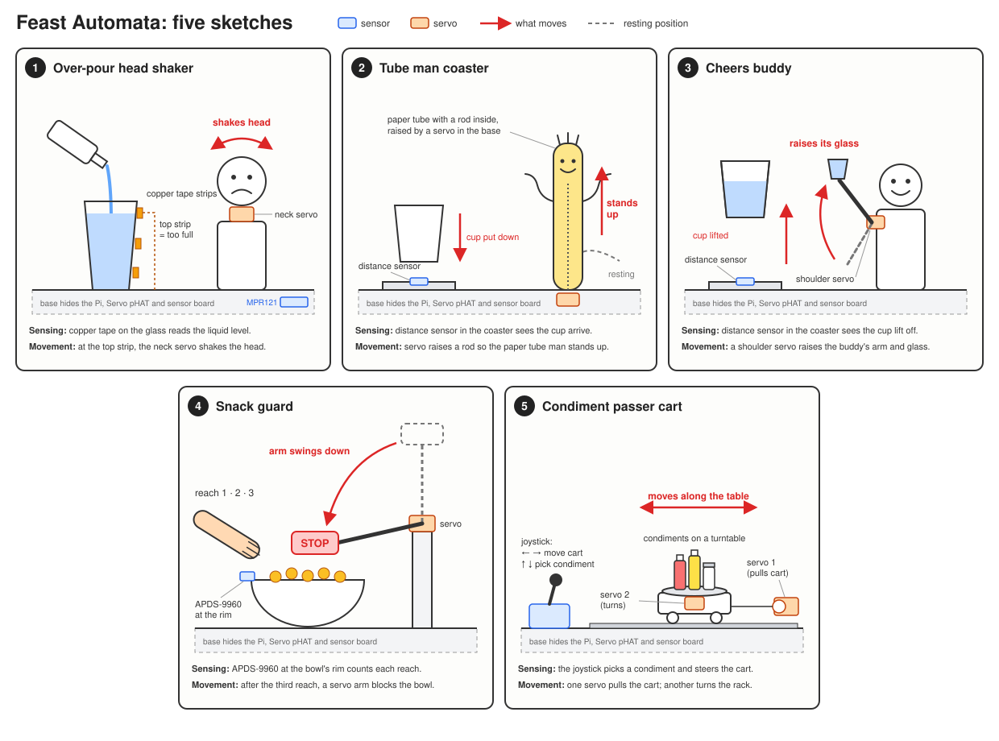
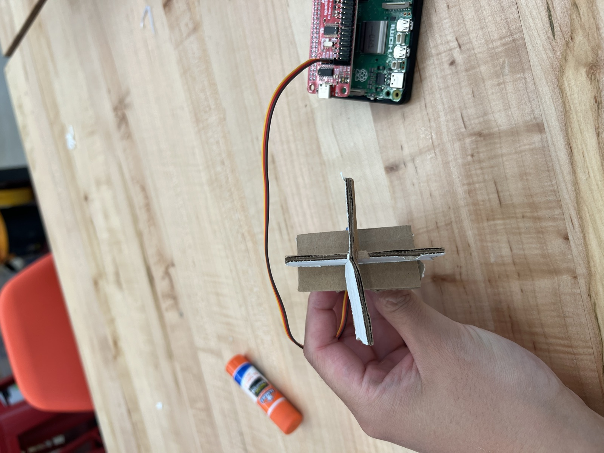
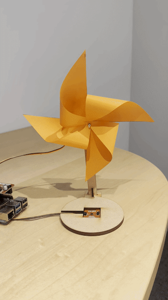
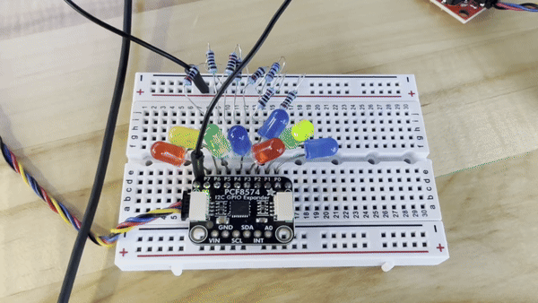
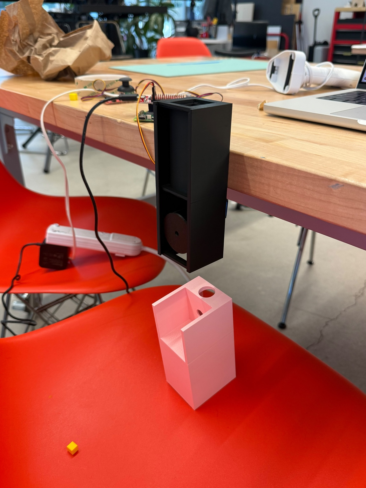
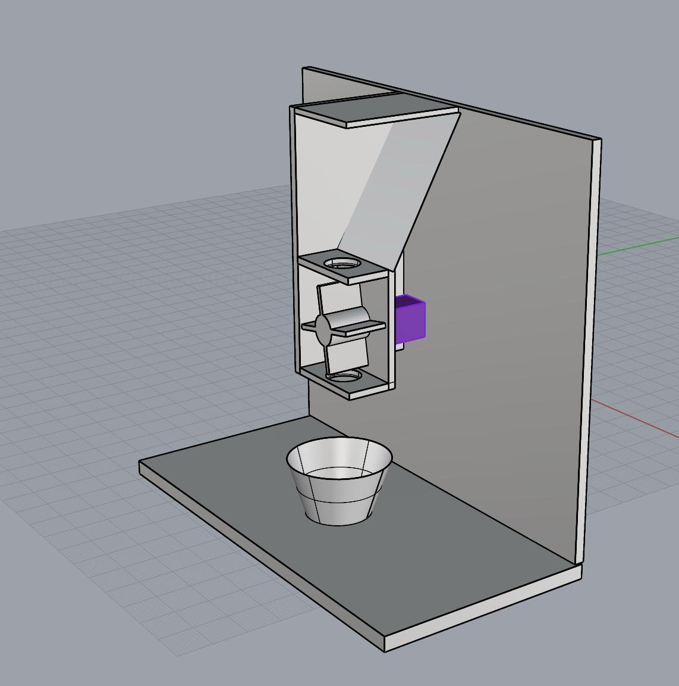
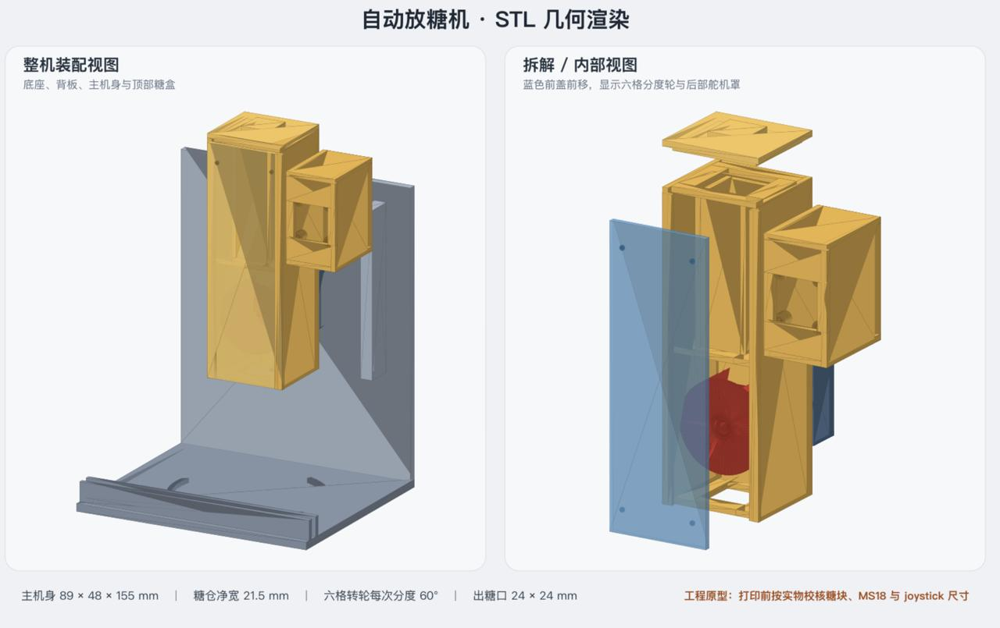

# Ph-UI!!!

> The course instructions are kept in ordinary text. My experiment notes, responses, and images appear in blockquotes.

<details>
	<summary><strong>Instructions for Students (Click to Expand)</strong></summary>
  
	**Submission Cleanup Reminder:**
	- This README.md contains extra instructional text for guidance.
	- Before submitting, remove all instructional text and example prompts from this file.
	- You may delete these sections or use the toggle/hide feature in VS Code to collapse them for a cleaner look.
	- Your final submission should be neat, focused on your own work, and easy to read for grading.
  
	This helps ensure your README.md is clear, professional, and uniquely yours!
</details>

---

---

## Lab Overview
> Team: Jiesen Huang, Serena Tsai, and Terence Zhang
>
> Members: Jiesen Huang ([certaindragon3](https://github.com/certaindragon3)), Serena Tsai (ht534, [ht534-ui](https://github.com/ht534-ui)), and Terence Zhang ([TerenceZhang29](https://github.com/TerenceZhang29))
>
> Project name: Sugar Cube Dropper


For lab this week, we focus on both sensing and actuation, bringing new modes of input and output into your devices, while also prototyping the physical structure and overall look of the device. You will consider how the physical form supports sensing and actuation, and how these elements come together to shape the interaction and aesthetics of the device.

---

## Lab Structure

A) [Capacitive Sensing](#part-a)

B) [More Sensors](#part-b)

C) [Servo Actuation](#part-c)

D) [Physical Interaction Design: Feast Automata](#part-d)

E) [Build & Integrate](#part-e)

F) [Final Documentation](#part-f)

---

## Part 1 Lab Preparation

---

### Get the latest content:
As always, pull updates from the class Interactive-Lab-Hub to both your Pi and your own GitHub repo. As we discussed in the class, there are 3 ways you can do so:


Option 1: On the Pi, `cd` to your `Interactive-Lab-Hub`, pull the updates from upstream (class lab-hub) and push the updates back to your own GitHub repo. You will need the personal access token for this.
```
pi@ixe00:~$ cd Interactive-Lab-Hub
pi@ixe00:~/Interactive-Lab-Hub $ git pull upstream Fall2026
pi@ixe00:~/Interactive-Lab-Hub $ git add .
pi@ixe00:~/Interactive-Lab-Hub $ git commit -m "get lab4 content"
pi@ixe00:~/Interactive-Lab-Hub $ git push
```

Option 2: On your own GitHub repo, [create pull request](https://github.com/FAR-Lab/Developing-and-Designing-Interactive-Devices/blob/2021Fall/readings/Submitting%20Labs.md) to get updates from the class Interactive-Lab-Hub. After you have latest updates online, go on your Pi, `cd` to your `Interactive-Lab-Hub` and use `git pull` to get updates from your own GitHub repo.

Option 3: (preferred) use the Github.com interface to update the changes.

---

### Quick Start: Python Environment Setup

1. **Create and activate a virtual environment in Lab 4:**
	```bash
	cd ~/Interactive-Lab-Hub/Lab\ 4
	python3 -m venv .venv
	source .venv/bin/activate
	```
2. **Install all Lab 4 requirements:**
	```bash
	pip install -r requirements2025.txt
	```
3. **Check CircuitPython Blinka installation:**
	```bash
	python blinkatest.py
	```
	If you see "Hello blinka!", your setup is correct. If not, follow the troubleshooting steps in the file or ask for help.

---

### Gathering materials for this lab:

* Cardboard (start collecting those shipping boxes!)
* Found objects and materials--like bananas and twigs.
* Cutting board
* Cutting tools
* Markers


(We do offer shared cutting board, cutting tools, and markers on the class cart during the lab, so do not worry if you don't have them!)

---

### Prototyping References 

* [What do prototypes prototype?](https://www.semanticscholar.org/paper/What-do-Prototypes-Prototype-Houde-Hill/30bc6125fab9d9b2d5854223aeea7900a218f149)
* [Paper prototyping](https://www.uxpin.com/studio/blog/paper-prototyping-the-practical-beginners-guide/) is used by UX designers to quickly develop interface ideas and run them by people before any programming occurs. 
* [Cardboard prototypes](https://www.youtube.com/watch?v=k_9Q-KDSb9o) help interactive product designers to work through additional issues, like how big something should be, how it could be carried, where it would sit. 
* [Tips to Cut, Fold, Mold and Papier-Mache Cardboard](https://makezine.com/2016/04/21/working-with-cardboard-tips-cut-fold-mold-papier-mache/) from Make Magazine.
* [Surprisingly complicated forms](https://www.pinterest.com/pin/50032245843343100/) can be built with paper, cardstock or cardboard.  The most advanced and challenging prototypes to prototype with paper are [cardboard mechanisms](https://www.pinterest.com/helgangchin/paper-mechanisms/) which move and change. 
* [Dyson Vacuum Cardboard Prototypes](http://media.dyson.com/downloads/JDF/JDF_Prim_poster05.pdf)
<p align="center"> </p>

### Feast Automata Inspirations

* [Simone Giertz - The Breakfast Machine](https://www.youtube.com/watch?v=E2evC2xTNWg) turns an everyday breakfast routine into a deliberately awkward robotic performance.
* [Pee-wee’s Big Adventure - Breakfast Machine](https://www.classhook.com/resources/1295-pee-wee-s-big-adventure-pee-wee-s-breakfast-machine?utm_source=chatgpt.com) An elaborate Rube Goldberg-style machine turns the ordinary routine of making breakfast into a playful mechanical performance.
* [Wallace & Gromit - The Autochef](https://www.google.com/search?sca_esv=66d2cd5ecf989ed9&sxsrf=APpeQnuwAWHrA3R0b1GeoQ4r-spKos3vUQ:1789367781228&udm=7&fbs=ABfTbFVyMZGZf1hfvX9uKjN_-G8cxpBkeIeqYwoCbfNVc4vKE7plZzta63Pe5DpJ3XFR9XzI_yj6fb6bfPt1x_5u3nRcG7tR9jg4Omd7-UnDuaw5i86wRQqe-045kPXObjb1eDS649ikhB0y_hSFYfNioDnA60A2i_oC1IzIZywb7ERnDQqnSx10JnfJEaAauzJXglx4123_vjf0_54bKrF6QjM9ne5i3g&q=Wallace+%26+Gromit+%E2%80%94+The+Autochef&sa=X&ved=2ahUKEwiI0OO3uu2WAxVHEFkFHQ3iAOEQtKgLegQIFRAB&biw=1197&bih=613&dpr=2.5#fpstate=ive&vld=cid:72c3eb07,vid:2igRcGxlshA,st:0)
* [Nik Ramage - Jelly Wobbler](http://www.youtube.com/watch?v=pj2t71q68sY#t=33) makes the simple act of wobbling jelly into a dedicated machine.
* [Zekun Chang - Blah Blah](https://zekunchang.com/portfolio/blah-blah/) is an alcohol machine that presents a playful commentary on drunken behavior.

### Mechanical Prototyping Resource

* [Gear Template Generator](https://woodgears.ca/gear_cutting/template.html) can help you prototype simple gear mechanisms for translating servo motion into physical movement.


---

### Part A
### Capacitive Sensing, a.k.a. Human-Twizzler Interaction 

We want to introduce you to the [capacitive sensor](https://learn.adafruit.com/adafruit-mpr121-gator) in your kit. It's one of the most flexible input devices we are able to provide. At boot, it measures the capacitance on each of the 12 contacts. Whenever that capacitance changes, it considers it a user touch. You can attach any conductive material. In your kit, you have copper tape that will work well, but don't limit yourself! In the example below, we use Twizzlers--you should pick your own objects.


<p float="left">

 
</p>

Plug in the capacitive sensor board with the QWIIC connector. Connect your Twizzlers with either the copper tape or the alligator clips (the clips work better). Install the latest requirements from your working virtual environment:

These Twizzlers are connected to pads 6 and 10. When you run the code and touch a Twizzler, the terminal will print out the following

```
(circuitpython) pi@ixe00:~/Interactive-Lab-Hub/Lab 4 $ python cap_test.py 
Twizzler 10 touched!
Twizzler 6 touched!
```

> I connected the MPR121 through Qwiic and tested the touch pads directly. I then connected an alligator lead to pad 0 and touched the exposed metal at the other end. The terminal detected touch and release events on channel 0.
>
> In the alligator-clip test, three clear touches lasted approximately 2.77, 2.35, and 4.58 seconds. There were also additional events during the test. After the final release, no new events appeared for approximately 60 seconds, and no other channels triggered. An earlier direct-pad test had short repeated events and one unusually long touch reading, so I have not yet established the cause of those readings.
>
> This test used the exposed metal of the alligator clip; I have not yet tested a separate food or foil object.
>
> 

---

### Part B
### More sensors

#### Light/Proximity/Gesture sensor (APDS-9960)

We here want you to get to know this awesome sensor [Adafruit APDS-9960](https://www.adafruit.com/product/3595). It is capable of sensing proximity, light (also RGB), and gesture! 
 

 

Connect it to your pi with Qwiic connector and try running the three example scripts individually to see what the sensor is capable of doing!

```
(circuitpython) pi@ixe00:~/Interactive-Lab-Hub/Lab 4 $ python proximity_test.py
...
(circuitpython) pi@ixe00:~/Interactive-Lab-Hub/Lab 4 $ python gesture_test.py
...
(circuitpython) pi@ixe00:~/Interactive-Lab-Hub/Lab 4 $ python color_test.py
...
```

> I replaced the MPR121 with the APDS-9960 using the Qwiic connection. In a 20-second proximity test, the raw readings ranged from 0 to 239. These are raw proximity values, not distances in centimeters.
>
> A separate 20-second light/color check returned 19 RGB and clear-channel samples. The clear-channel readings ranged from 39 to 10,949 during the shading exercise. This confirms changing light readings and working RGB data retrieval; it does not establish accurate color recognition.
>
> Neither the first 20-second gesture check nor a separate 30-second check returned any direction events. Gesture recognition remains unverified. I have not established whether the cause is the motion, sensor placement, or configuration.

You can go the the [Adafruit GitHub Page](https://github.com/adafruit/Adafruit_CircuitPython_APDS9960) to see more examples for this sensor!

#### Rotary Encoder 

A rotary encoder is an electro-mechanical device that converts the angular position to analog or digital output signals. The [Adafruit rotary encoder](https://www.adafruit.com/product/4991#technical-details) we ordered for you came pre-soldered, so you do NOT need to solder anything.
<p float="left">

   


</p>

Connect it to your pi with Qwiic connector and try running the example script, it comes with an additional button which might be useful for your design!

```
(circuitpython) pi@ixe00:~/Interactive-Lab-Hub/Lab 4 $ python encoder_test.py
```

You can go to the [Adafruit Learn Page](https://learn.adafruit.com/adafruit-i2c-qt-rotary-encoder/python-circuitpython) to learn more about the sensor! The sensor actually comes with an LED (neo pixel): Can you try lighting it up? 

> The encoder was detected at address 0x36 with product ID 4991. The first check verified communication and sent red, green, and blue commands to the board's NeoPixel, then turned it off. I visually confirmed all three colors. The LED check used seesaw pin 6, following the linked Adafruit example.
>
> A separate 25-second input check recorded the position increasing from 0 to 75 and then decreasing to 61 when the rotation was reversed. It also recorded two complete button presses and releases. These results confirm rotation in both directions, the pushbutton, and visible LED output.

#### Joystick 


A [joystick](https://www.sparkfun.com/products/15168) can be used to sense and report the input of the stick for it pivoting angle or direction. It also comes with a button input!

<p float="left">

</p>

Connect it to your pi with Qwiic connector and try running the example script to see what it can do!

```
(circuitpython) pi@ixe00:~/Interactive-Lab-Hub/Lab 4 $ python joystick_test.py
```

> I connected the Qwiic joystick and checked both axes and its pushbutton. The detected firmware version was v2.6. During a 45-second check, both X and Y ranged from 0 to 1023, and the stick returned to approximately X=508, Y=510 after the directional inputs.
>
> The first check contained no button changes. A separate 20-second button check recorded 1 → 0 → 1, confirming one complete press and release: 0 was pressed and 1 was released.

You can go to the [SparkFun GitHub Page](https://github.com/sparkfun/Qwiic_Joystick_Py) to learn more about the sensor!

#### Distance Sensor


Earlier we have asked you to play with the proximity sensor, which is able to sense objects within a short distance. Here, we offer [Sparkfun Proximity Sensor Breakout](https://www.sparkfun.com/products/15177), With the ability to detect objects up to 20cm away.

<p float="left">


</p>

Connect it to your pi with Qwiic connector and try running the example script to see how it works!

```
(circuitpython) pi@ixe00:~/Interactive-Lab-Hub/Lab 4 $ python qwiic_distance.py
```

> I connected the VCNL4040 and ran a 25-second proximity check. The 63 readings ranged from 0 to 20,869, with repeated high-to-low changes during the near/far exercise. Several low periods were around 3–4, and the final reading was 3.
>
> The test confirms a changing proximity signal suitable for exploring object-presence detection. These are raw readings, not calibrated distances. A threshold for the final interaction still needs to be chosen using the actual object and sensor placement.

You can go to the [SparkFun GitHub Page](https://github.com/sparkfun/Qwiic_Proximity_Py) to learn more about the sensor and see other examples

---

### Part C
### Servo Actuation

Now that you have explored several forms of sensing, add physical output by learning to control a servo motor. Complete the Servo pHAT setup and basic servo test before beginning your interaction design.

### Servo Control with SparkFun Servo pHAT
For this lab, you will use the **SparkFun Servo pHAT** to control a micro servo (such as the Miuzei MS18 or similar 9g servo). The Servo pHAT stacks directly on top of the Adafruit Mini PiTFT (135×240) display without pin conflicts:
- The Mini PiTFT uses SPI (GPIO22, 23, 24, 25) for display and buttons ([SPI pinout](https://pinout.xyz/pinout/spi)).
- The Servo pHAT uses I²C (GPIO2 & 3) for the PCA9685 servo driver ([I2C pinout](https://pinout.xyz/pinout/i2c)).
- Since SPI and I²C are separate buses, you can use both boards together.
**⚡ Power:**
- Plug a USB-C cable into the Servo pHAT to provide enough current for the servos. The Pi itself should still be powered by its own USB-C supply. Do NOT power servos from the Pi’s 5V rail.

<p align="center">
    
</p>

**Basic Python Example:**
We provide a simple example script: `Lab 4/pi_servo_hat_test.py` (requires the `pi_servo_hat` Python package).
Run the example:
```
python pi_servo_hat_test.py
```
For more details and advanced usage, see the [official SparkFun Servo pHAT documentation](https://learn.sparkfun.com/tutorials/pi-servo-phat-v2-hookup-guide/all#resources-and-going-further).

> I checked the SIG, 5V, and GND connections and attempted an unloaded, finite channel-0 test using [servo_center_test.py](servo_center_test.py). The test sends two short sequences around the center pulse, using approximately 1.417–1.583 ms pulses, and finishes at 1.5 ms.
>
> The channel-0 commands completed, and the controller registers matched the intended center configuration. However, I observed no servo movement, including on a repeat run.
>
> I then moved the same servo to channel 1 and repeated the same short test using `python servo_center_test.py --channel 1`. The servo moved back and forth normally and returned to center. This verifies basic unloaded actuation on channel 1. The reason for the channel-0 failure is still unresolved; I have not established whether it was contact, wiring, or a channel fault. Future integration will use channel 1.

A servo motor is a rotary actuator that allows for precise control of angular position. The position is set by the width of an electrical pulse (PWM). You can read [this Adafruit guide](https://learn.adafruit.com/adafruit-arduino-lesson-14-servo-motors/servo-motors) to learn more about how servos work.

---

### Part D
### Physical Interaction Design: Feast Automata

> The development notes below record earlier iterations. The tested prototype and current limitations are documented in Part E.
>
> **October 18 iteration — two-slot ring:** I replaced the proposed four-compartment mechanism with a ring having slots at opposite ends and requested a 180° movement between releases. The new `--ring-180` test alternates between two endpoints: one full clockwise joystick circle moves to the opposite endpoint, and the next accepted circle moves back. It holds each endpoint and does not automatically return after a request, avoiding an extra unrequested pass across the outlet. Whether either direction actually releases exactly one cube still needs testing.
>
> Start the mounted-ring test on Orange with `python sugar_dispenser.py --hardware --ring-180 --channel 1`. The initial test uses an empty ring, a provisional 0.5–2.4 ms pulse range, and a three-second linear command ramp followed by settling time. The joystick button stops motion without rewinding. Startup commands center first and then approaches the starting endpoint; it does not measure the shaft position. Pulses are based on a [firsthand MS18 test reporting approximately 180° over this range](https://qiita.com/shuji4649/items/3f7220cf27f75b0a576f), not a measured calibration of this assembly. Movement and clearance must be observed before loading sugar. During this initial test, circles traced while moving are ignored; wait until the ring stops before the next circle. The earlier four-slot and unloaded-test iterations remain below for context.
>
> The October 18 update was deployed to Orange after backing up the previous scripts. All 35 logic and mocked-adapter tests, compilation, and the six-request alternating-motion simulation passed on Orange; deployed source hashes matched the Mac files. These checks verify the control commands and state transitions, not actual 180° travel, mechanical clearance, or sugar delivery.

> **Planned prototype: joystick-controlled sugar-cube dispenser.** Each of four compartments holds one cube. The selected interaction is one complete clockwise circle of the joystick for one indexing cycle, intended to advance the sugar wheel by one 90° compartment after calibration. A quarter-circle or half-circle does not trigger. The stick must be centered for 0.2 seconds at startup; then the user traces a circle away from the center. Reverse motion subtracts from progress, returning toward the center cancels an incomplete circle, and holding one direction does not repeat the request. Bounded modes discard input during movement. The continuous empty-test mode continues recognizing circles and queues up to four pending cycles. Pressing the joystick button clears pending cycles, stops the program, and disables this servo channel's PWM without automatically rewinding the wheel. The earlier push-and-return interaction remains available with `--gesture push`.
>
> **Continuous empty-test mode:** `python sugar_dispenser.py --hardware --continuous --channel 1` performs one outward stroke, waits, and returns for each complete clockwise circle. It does not stop after one or four cycles. Circles completed while the servo is moving enter a queue; overflow is reported with a request to slow down. A queue is not proof of dispensed sugar. This mode is currently for the unloaded servo. Actual one-cube delivery needs the proposed one-way mechanism or a different metering mechanism that releases only on the outward stroke.
>
> The proposed actuator is a Miuzei MS18 9g position servo. Its finite travel cannot directly drive unlimited same-direction quarter-turns. [sugar_dispenser.py](sugar_dispenser.py) therefore provides a bounded `direct` mode and a proposed `ratchet` mode. Ratchet mode requires a physical drive pawl and an anti-reverse pawl (or an equivalent one-way indexing mechanism): the outward stroke advances the wheel, and the return stroke resets the drive without reversing the wheel. This mechanism has not been built or tested. With default settings, direct mode allows only one outward stroke, then locks at the travel limit.
>
> The wheel also needs a stationary floor, a single-cube outlet, and an initial closed position or shutter so loading does not immediately release a cube. Each compartment should hold only one cube, and the outlet must not expose two compartments at once. The rotor's actual advance must be measured and adjusted to one 90° compartment; a software pulse or angle command alone does not prove this motion or a successful drop.
>
> **Local simulation:** from `Lab 4`, run `python3 sugar_dispenser.py` for bounded direct drive or `python3 sugar_dispenser.py --mode ratchet` for the proposed four-cycle mechanism. Neither command imports hardware libraries or operates a motor. Run `python3 -m unittest -v test_sugar_dispenser.py` to check the control logic.
>
> **Future Pi operation:** after transferring the source to Orange and activating the isolated Lab 4 environment, run `python sugar_dispenser.py --hardware --mode direct --channel 1`. Use `--mode ratchet` only after installing the one-way mechanism. The joystick uses Qwiic; the servo uses pHAT channel 1, following the earlier channel-1 test, with separate pHAT power. No display control is needed. Run only one pHAT application at a time because its initialization resets the controller.
>
> Clockwise recognition assumes X increases toward the user's right and Y toward the user's bottom. Check the installed joystick's raw readings; use `--x-sign -1` and/or `--y-sign -1` if those axes are reversed. A complete circle is accumulated from small angular changes, including the wrap between −180° and +180°. Angular jumps over 45° or sample gaps over 0.25 seconds reset progress, so trace the circle smoothly. These orientation assumptions have not yet been checked on the assembled device.
>
> `--home-ms`, `--step-ms`, and `--limit-ms` configure pulse widths, not verified shaft angles. CLI defaults now use 0.875 → 2.125 ms at 50 Hz. During unloaded testing, I reported that the 1.0 → 2.0 ms movement was approximately 60°, that 0.75 → 2.25 ms exceeded 90°, and that the intermediate range appeared close to 90°. These are visual estimates, not angular measurements; the final intermediate run's log did not record a completed joystick-triggered cycle before it was stopped, so the selected range remains provisional. Continuous-mode actuation and rotor travel need checking on the assembled mechanism. The program requires an empty mechanism before homing; the continuous test keeps it empty afterward. Restarting does not recover the wheel position or inventory; inspect and unload first.
>
> The bounded-mode four-cycle counter is an inventory estimate based on completed commands. It cannot detect jams, a missed cube, an empty compartment, or actual arrival in the cup. The initial version has no cup-presence interlock or drop sensor. On October 14, 2026, the initial program was deployed to `/home/pi/Interactive-Lab-Hub/Lab 4` on Orange, with matching source hashes and 22 passing tests, without motor actuation. Subsequent unloaded tests commanded channel 1 around center and at wider pulse ranges; I confirmed visible movement and gave the visual angle estimates above. The continuous empty-test update also matched the Mac source hashes and passed all 28 control and mocked-adapter tests on Orange. It was started on channel 1 and reached READY. The boot display remained active. Integrated rotor behavior and actual sugar delivery remain unverified.

**Feast Automata:** build a device that **transforms ordinary dining rituals into playful physical interactions.** Begin with a familiar experience around eating, drinking, cooking, serving, or sharing food, and explore how sensing and actuation might augment, exaggerate, automate, or reinterpret your dining experience.

In this part, use the sensing techniques from Parts A–B and the servo actuation from Part C to develop a physical interaction.

#### Physical considerations for sensing

Sensors need to be positioned in specific locations or orientations to make them useful for an application. Choose a sensor that fits the dining interaction you want to explore. For example, a distance sensor could detect when a cup is placed on a coaster; where the sensor is positioned determines what it can reliably detect.

Think about how the larger object needs to be shaped so the sensor can work reliably, where the actuator needs to sit, what moves, and how a person encounters the interaction.

#### Physical Form and Housing

Think about how your sensor, actuator, and electronics are physically arranged within your prototype. Consider where components need to be placed, what parts move, how the device is supported or enclosed, and how the overall form and aesthetics shape the interaction.

Use cardboard, paper, found objects, or other low-fidelity materials to quickly prototype the physical structure before refining your final design.

#### Optional Display Feedback: Qwiic OLED

Your kit includes these [SparkFun Qwiic OLED screens](https://www.sparkfun.com/products/17153). These use less power than the MiniTFTs you have mounted on the GPIO pins of the Pi, but, more importantly, they can be more flexibly mounted elsewhere on your physical interface. The way you program this display is almost identical to the way you program a  Pi display. Take a look at `oled_test.py` and some more of the [Adafruit examples](https://github.com/adafruit/Adafruit_CircuitPython_SSD1306/tree/master/examples).

<p float="left">


</p>


As you develop your Feast Automata concept, consider where the sensor and actuator need to be placed, what parts move, how electronics are housed, and how the overall form and aesthetics support the interaction.

**\*\*\*Draw 5 sketches that explore different physical arrangements for your sensing and actuation.\*\*\***

> The following sketch pass and initial prototype questions are from Terence Zhang's [Lab 4 draft](https://github.com/TerenceZhang29/Interactive-Lab-Hub/tree/Fall2026/Lab%204), included here as collaborative ideation.
>
> 
>
> 1. **Over-pour head shaker.** Copper tape strips on the outside of a glass connect to a capacitive sensor; the figure's neck shakes its head when the drink reaches a threshold.
> 2. **Sugar-cube dropper.** A distance sensor in a coaster detects a cup, and a servo opens a hopper gate so one sugar cube slides down a chute into the cup.
> 3. **Cheers buddy.** A distance sensor detects when a cup is lifted; a servo raises a figure's arm and a small cardboard glass, then lowers it when the cup is put down.
> 4. **Snack guard.** An APDS-9960 proximity or gesture sensor counts reaches into a bowl; after the third reach, a servo swings a stop arm or lid over the bowl briefly.
> 5. **Condiment passer.** A joystick controls the direction of small wheel carts that carry condiments across the table.

**\*\*\*What questions do these sketches raise? What do you need to physically prototype to answer them?\*\*\***

> 1. Can capacitive sensing detect liquid level through the glass, and can someone still lift and drink from it with wires attached? Build a mock-up with the sensor and wiring in place to check.
> 2. Can the servo gate release exactly one sugar cube without jamming, and will the cube land in the cup instead of bouncing out? Build the hopper and chute, then test real sugar cubes at different chute angles.
> 3. Would the movement interfere with picking up or putting down the cup? Check whether the design leaves enough space and whether the motion happens at a discoverable time.
> 4. Does the rim sensor count one reach once, or double-count the hand entering and leaving? Test the interaction and tune the counting behavior.
> 5. Will condiment bottles stay upright when the carts start and stop? Load a cart with representative weight and test it.

**\*\*\*Pick one design to prototype and explain why.\*\*\***

> We picked design 2, the sugar cube dropper. It has the clearest sense → act loop (cup goes down, sugar goes in), it only needs one sensor and one servo, and it raised the most physical questions to answer with cardboard: how cubes are held, released, and guided into the cup.
>
> **Pivot: from a gate to a rotating wheel.** In the sketch, a servo opened a gate under the hopper so a cube could slide out. Once we started building it, a gate looked hard to control. How many cubes fall depends on how long the gate stays open and how the cubes are stacked, so it could release zero, one, or several at once, and cubes could jam half-way through. We switched to a rotating wheel instead: a cardboard cross mounted on the servo horn divides the space under the hopper into four pockets. Each pocket holds one cube, and each 90° turn of the servo carries one pocket from the hopper to the chute and drops its cube. This is easier to control with the servo, since we just send it to fixed angles instead of timing an open/close, and it makes the dose easy to set: one turn for one cube, two turns for two.
>
> One limitation: our servo (Miuzei MS18 micro servo) only rotates 0–180°, not continuously. So the wheel can step 0° → 90° → 180° to drop up to two cubes, then has to swing back to 0° to reset before the next round. We still need to test whether the pockets pick up or drop extra cubes on the way back, and whether the micro servo has enough torque to push the wheel through a full hopper without stalling.

Build a cardboard or other low-fidelity physical prototype of your design.

**\*\*\*Document your rough prototype with photos and/or video.\*\*\***

>   


---

## Part 2

Following exploration and reflection from Part 1, complete the "looks like," "works like" and "acts like" prototypes for your design, reiterated below.

---

### Part E

#### Build & Integrate: Sensing + Actuation

For Part 2, build the Feast Automata interaction you developed in Part D by connecting sensing/input to physical actuation.

**Your prototype should:**
- Use at least one sensing or input device.
- Use servo-based physical actuation.
- Connect sensing and actuation into a meaningful interaction around eating, drinking, cooking, serving, or sharing food.
- Additional inputs, displays, LEDs, buttons, or other outputs are optional extensions.

**Document your system with:**
- Code for your sensing + actuation prototype
- Photos and/or video of the working prototype in action
- A simple interaction diagram or sketch showing how sensing and actuation are connected
- Written reflection: What did you learn about connecting sensing, movement, and physical form? What was fun, surprising, or challenging?

**Questions to consider:**
- How does your chosen sensor or input shape the physical response?
- How does the physical arrangement of the sensor and actuator change the interaction?
- What thresholds, timing, or movement patterns make the interaction feel clear or playful?
- What changes when you adjust the sensor placement or servo motion?

Iterate on the sensing, movement, and physical form, and document what you discover.

> #### Our Integrated Prototype: Joystick Sugar Cube Dropper
>
> Our prototype turns requesting sugar into a deliberate circular gesture. The user rotates a Qwiic joystick through one complete clockwise circle. A Raspberry Pi reads both axes and commands a Miuzei MS18 servo on Servo pHAT channel 1 to move the two-slot rotator to its opposite endpoint, approximately a half-turn. The next accepted circle moves it back. The servo holds each endpoint instead of automatically returning across the outlet after the same request.
>
> The mounted interaction was tested successfully on Orange. Our three team members then took turns using the device and found that complete circles reliably triggered the delivery action. The current demonstration still requires manual feeding from above: the printed hopper does not yet meter cubes automatically into the rotator. The outlet can also catch a cube. These mechanical limitations are part of the tested prototype, rather than completed features of an automatic dispenser.
>
> | Stage | Input or state | Response |
> |---|---|---|
> | Startup | Empty mechanism; joystick centered for 0.2 seconds | Servo initializes, then the program becomes ready |
> | Gesture | User traces a full clockwise circle away from center | The program accumulates the angle from both axes |
> | Movement | One complete circle is recognized | The rotator slowly moves to the opposite endpoint and holds |
> | Delivery | A cube is manually fed into the mechanism | Gravity carries it toward the cup if the pocket and bottom outlet are clear |
> | Next request | The previous movement and waiting periods finish | A new complete circle requests a half-turn in the other direction |
> | Stop | User presses the joystick button | Motion stops and the channel's PWM is disabled without rewinding |
>
> ```mermaid
> flowchart TD
>     A[Full clockwise joystick circle] --> B[X and Y angle accumulation]
>     B --> C[One slow half-turn command]
>     C --> D[Hold the opposite endpoint]
>     D --> E[Ready for a new full circle]
>     E --> A
>     M[Manual sugar feed] --> N[Rotator pocket and bottom outlet]
>     C --> N
>     N --> P[Cube falls toward the cup if the path is clear]
> ```
>
> #### Code
>
> The working implementation is [sugar_dispenser.py](sugar_dispenser.py). Its state-machine checks are in [test_sugar_dispenser.py](test_sugar_dispenser.py), and the hardware packages are listed in [requirements2025.txt](requirements2025.txt). The 35 automated checks cover gesture recognition, movement limits, alternating endpoints, gradual motion, and stopping; they are separate from the three-person usability testing described below.
>
> The joystick reports 10-bit X/Y readings. We use the observed center, approximately `(508, 510)`, as the origin and compute the angle around that point. Small signed angular changes are added until they reach one clockwise revolution. Reversing direction subtracts from the accumulated angle; returning inside the circle's minimum radius cancels an incomplete gesture. Holding one direction does not accumulate a circle.
>
> | Setting in the tested implementation | Value and purpose |
> |---|---|
> | Startup neutral range | Both axes within 100 counts of their center for 0.2 seconds |
> | Minimum circle radius | 300 counts from the center, using both axes together |
> | Trigger | One accumulated clockwise revolution, or `2π` radians |
> | Discontinuity checks | Reset progress after a gap over 0.25 seconds or an angular jump over 45° |
> | Polling pause | 0.02 seconds between input-loop iterations |
> | Servo connection | Channel 1 on the separately powered SparkFun Servo pHAT |
> | Half-turn command range | 0.5–2.4 ms pulses at nominally 50 Hz; mechanical alignment is checked on the device |
> | Movement timing | A 3-second gradual ramp, followed by 0.6 seconds settling and 0.5 seconds release waiting |
> | Two-slot behavior | Alternate endpoints once per request; no automatic return and no four-cube software stop |
> | Input during movement | Ignored in the final `--ring-180` mode; wait until the rotator stops before the next circle |
>
> To run the final two-slot mechanism on Orange, use its existing Lab 4 environment:
>
> ```bash
> cd "/home/pi/Interactive-Lab-Hub/Lab 4"
> .venv/bin/python sugar_dispenser.py --hardware --ring-180 --channel 1
> ```
>
> Start with the ring empty so startup positioning and clearance can be checked. The joystick button or `Ctrl+C` stops the program. A desktop simulation is available with `python3 sugar_dispenser.py --ring-180`; it does not operate hardware. The earlier `--continuous` mode is an unloaded advance-and-return experiment, not the final two-slot dispensing mode.
>
> Returning to neutral is required at startup, but the final program does not require a center return after every completed serving. Once movement finishes, it accepts a fresh complete circle. Its counter records completed motion commands; there is no sensor confirming that a cube reached the cup.
>
> #### Working Prototype Evidence
>
> 
>
> 
>
> https://github.com/user-attachments/assets/81d6da97-3d35-4f37-8aa2-4dcf771754c9
>
> [Watch or download the landscape MP4](assets/video/sugar-cube-dropper-demo-landscape.mp4) · 25.4 seconds · [Original recording](assets/video/working-prototype-original.mp4)
>
> The demonstration shows joystick operation and the mounted rotator releasing cubes toward the cup. The video retains the full recording duration and original audio. The feeding and outlet limitations are discussed below.
>
> #### Written Reflection: Usability Testing and Next Iteration
>
> **Usability testing.** The three members of our team took turns using the assembled device. Each person used the joystick to request sugar and observed the rotator's response. This was informal, formative usability testing during development. It helped us check whether the gesture-to-movement connection was reliable and whether the device responded at a comfortable pace. It also made the remaining feeding and delivery problems visible in the actual assembly.
>
> **Input.** We kept the current joystick thresholds because completing a circle reliably triggered the delivery action during our trials. Reading X and Y together matters: a change in one axis does not establish that someone has completed a circular motion. The center range and minimum radius give the program a way to separate a deliberate circle from movement near the resting position. Our qualitative observations supported retaining these settings for this prototype.
>
> **Output.** We also retained the existing 3-second servo movement. All three of us tried the current interaction, and we were satisfied with its stability and dispensing speed. We wanted the rotation to feel deliberate without creating an unnecessarily long wait, while avoiding an abrupt movement that could disturb the sugar. We kept that timing and focused our next iteration on the feeder and outlet. The program also leaves settling and release time before accepting another request. Alternating endpoints was important for the two-slot design: returning automatically after one request would send the mechanism back across the outlet before the user had requested another serving.
>
> **The feeder did not match the intended geometry.** Our intended mechanism had two opposite sugar-cube pockets. During a 180° turn, the solid section between the pockets was supposed to block the storage opening. Only when the empty lower pocket reached the top would another cube fall into it. The printed pockets were longer than we intended, and the storage compartment had no partition extending down to the rotator. There was also a vertical gap between them. As a result, the rotator's solid section could not actually close the path from the storage compartment. During the demonstration we manually fed sugar from above. The gesture and servo movement worked, but automatic replenishment from the hopper remains an unfinished part of the design.
>
> **The bottom of the housing could trap a cube.** We also found that the opening below the rotator was too small. This was a problem with the housing's lower floor, not the pockets on the rotating part. A cube could land on the remaining bottom partition and stay there instead of falling directly into the coffee cup. Our next version should open the entire intended fall path beneath the rotator. Any structural support should sit outside that path so the housing supports the mechanism without becoming a shelf that catches sugar.
>
> **Next iteration.** We would keep the current gesture thresholds and timing while first correcting those mechanical interfaces. A stationary feed guide or partition should reach close enough to the rotator for its solid section to block the storage opening. We would also shorten the pockets to the intended single-cube geometry and enlarge the housing's bottom outlet. Before printing another complete enclosure, we could test a removable feeder insert and an open-bottom mock-up with real cubes. That would let us check automatic loading and release in both directions at lower cost. Because all three testers helped build the device, a later usability test should also include someone unfamiliar with it and record missed gestures, cubes caught at the outlet, and how much guidance they need.

See encoder_accel_servo_dashboard.py in the Lab 4 folder for an optional example of chaining together three devices.

**`Lab 4/encoder_accel_servo_dashboard.py`**

#### Example Application: Windmill Coaster

Now that you have explored both sensing and actuation, here is a simple example that combines the two.

The **Windmill Coaster** uses a Qwiic distance/proximity sensor to detect when a cup is placed on a coaster. When the cup is detected, a servo motor animates a small windmill by sweeping it back and forth, turning an ordinary action during drinking into a playful physical interaction.

<p align="center">
    
</p>


This example demonstrates a simple interaction pipeline:

**cup placed → distance sensor detects cup → servo actuates windmill**

Connect the Qwiic distance sensor to the Pi and connect the servo to Channel 0 of the Servo pHAT. Make sure the Servo pHAT is powered through its USB-C connection.

Run the example script:

```bash
python windmill_coaster.py
```

The script continuously reads the proximity value from the distance sensor. When the value passes a threshold, the servo begins animating the windmill. When the cup is removed, the servo stops and returns to its resting position.

You may need to adjust `CUP_THRESHOLD` in [`windmill_coaster.py`](windmill_coaster.py) depending on the size of your cup and the physical placement of the sensor. You can run `qwiic_distance.py` first to compare readings with and without a cup.

Use this example as a starting point. Change the sensor, movement, physical form, or dining interaction to create your own Feast Automata variation.

#### Optional Extensions

The following examples are optional resources if you want to add more inputs or outputs to your prototype.

##### Using Multiple Qwiic Buttons: Changing I2C Address (Physically & Digitally)

If you want to use more than one Qwiic Button in your project, you must give each button a unique I2C address. There are two ways to do this:

##### 1. Physically: Soldering Address Jumpers

On the back of the Qwiic Button, you'll find four solder jumpers labeled A0, A1, A2, and A3. By bridging these with solder, you change the I2C address. Only one button on the chain can use the default address (0x6F).

**Address Table:**

| A3 | A2 | A1 | A0 | Address (hex) |
|----|----|----|----|---------------|
|  0 |  0 |  0 |  0 |    0x6F       |
|  0 |  0 |  0 |  1 |    0x6E       |
|  0 |  0 |  1 |  0 |    0x6D       |
|  0 |  0 |  1 |  1 |    0x6C       |
|  0 |  1 |  0 |  0 |    0x6B       |
|  0 |  1 |  0 |  1 |    0x6A       |
|  0 |  1 |  1 |  0 |    0x69       |
|  0 |  1 |  1 |  1 |    0x68       |
|  1 |  0 |  0 |  0 |    0x67       |
| ...| ...| ...| ... |     ...      |

For example, if you solder A0 closed (leave A1, A2, A3 open), the address becomes 0x6E.

**Soldering Tips:**
- Use a small amount of solder to bridge the pads for the jumper you want to close.
- Only one jumper needs to be closed for each address change (see table above).
- Power cycle the button after changing the jumper.

##### 2. Digitally: Using Software to Change Address

You can also change the address in software (temporarily or permanently) using the example script `qwiic_button_ex6_changeI2CAddress.py` in the Lab 4 folder. This is useful if you want to reassign addresses without soldering.

Run the script and follow the prompts:
```bash
python qwiic_button_ex6_changeI2CAddress.py
```
Enter the new address (e.g., 5B for 0x5B) when prompted. Power cycle the button after changing the address.

**Note:** The software method is less foolproof and you need to make sure to keep track of which button has which address!


##### Using Multiple Buttons in Code

After setting unique addresses, you can use multiple buttons in your script. See these example scripts in the Lab 4 folder:

- **`qwiic_1_button.py`**: Basic example for reading a single Qwiic Button (default address 0x6F). Run with:
	```bash
	python qwiic_1_button.py
	```

- **`qwiic_button_led_demo.py`**: Demonstrates using two Qwiic Buttons at different addresses (e.g., 0x6F and 0x6E) and controlling their LEDs. Button 1 toggles its own LED; Button 2 toggles both LEDs. Run with:
	```bash
	python qwiic_button_led_demo.py
	```

Here is a minimal code example for two buttons:
```python
import qwiic_button

# Default button (0x6F)
button1 = qwiic_button.QwiicButton()
# Button with A0 soldered (0x6E)
button2 = qwiic_button.QwiicButton(0x6E)

button1.begin()
button2.begin()

while True:
		if button1.is_button_pressed():
				print("Button 1 pressed!")
		if button2.is_button_pressed():
				print("Button 2 pressed!")
```

For more details, see the [Qwiic Button Hookup Guide](https://learn.sparkfun.com/tutorials/qwiic-button-hookup-guide/all#i2c-address).

---

##### PCF8574 GPIO Expander: Add More Pins Over I²C

Sometimes your Pi’s header GPIO pins are already full (e.g., with a display or HAT). That’s where an I²C GPIO expander comes in handy.

We use the Adafruit PCF8574 I²C GPIO Expander, which gives you 8 extra digital pins over I²C. It’s a great way to prototype with LEDs, buttons, or other components on the breadboard without worrying about pin conflicts—similar to how Arduino users often expand their pinouts when prototyping physical interactions.

**Why is this useful?**
- You only need two wires (I²C: SDA + SCL) to unlock 8 extra GPIOs.
- It integrates smoothly with CircuitPython and Blinka.
- It allows a clean prototyping workflow when the Pi’s 40-pin header is already occupied by displays, HATs, or sensors.
- Makes breadboard setups feel more like an Arduino-style prototyping environment where it’s easy to wire up interaction elements.

**Demo Script:** `Lab 4/gpio_expander.py`

<p align="center">
    
</p>

We connected 8 LEDs (through 220 Ω resistors) to the expander and ran a little light show. The script cycles through three patterns:
- Chase (one LED at a time, left to right)
- Knight Rider (back-and-forth sweep)
- Disco (random blink chaos)

Every few runs, the script swaps to the next pattern automatically:
```bash
python gpio_expander.py
```

This is a playful way to visualize how the expander works, but the same technique applies if you wanted to prototype buttons, switches, or other interaction elements. It’s a lightweight, flexible addition to your prototyping toolkit.

---


---

---

### Part F

### Final Documentation

> #### Sugar Cube Dropper: Final Interaction
>
> The Sugar Cube Dropper turns adding sugar into a small physical ritual: a full clockwise joystick circle requests a half-turn of a servo-driven rotator. The tested version uses two pockets at opposite ends of the rotator and alternates between endpoints. We manually feed sugar from above because the current storage compartment does not yet meter cubes into those pockets automatically.
>
> #### Looks Like
>
> The prototype has a black 3D-printed housing with a storage compartment above a cylindrical rotator and an outlet below. Its open front exposes the mechanism. The Raspberry Pi, Servo pHAT, and separate joystick sit beside it. In the prototype setup, the housing is positioned at the table edge so a cup can be placed beneath the outlet.
>
> 
>
> #### Design Iterations
>
> The early concept combined cup detection with a timed gate. We explored a rotating mechanism in cardboard, then developed the housing, feeder, and servo placement in CAD before assembling the printed two-slot rotator. The final input became a deliberate joystick circle.
>
> 
>
> 
>
> 
>
> 
>
> 
>
> These cardboard and CAD images document earlier explorations. The mounted printed mechanism is shown in Part E. Its working feed and outlet geometry still differ from the intended automatic path, as discussed in the reflection.
>
> 
>
> **Final design used for printing.** The rendering shows the enclosure assembly and an exploded view of its internal structure. Its six-pocket, 60° wheel annotation describes the CAD model; our tested assembly uses the two-slot rotator and alternating 180° movement documented in Part E.
>
> #### Works Like
>
> X/Y joystick readings describe movement around the center. The program recognizes a complete clockwise circle, slowly turns the rotator to the opposite endpoint, and holds there. Once that movement and its waiting periods finish, another full circle requests the reverse half-turn. A cube can then travel toward the cup through the rotator and bottom opening, with manual feeding and occasional outlet obstruction as current limitations.
>
> #### Acts Like
>
> The user places a cup below the outlet and draws a full clockwise circle with the joystick. The circular action feels like operating a small serving machine. The user waits for the rotator to stop before requesting another cube. Releasing the joystick between requests is a natural way to separate gestures, although the code requires a centered stick only at startup. A team member currently supplies sugar manually from above.
>
> | Prototype lens | What the current prototype demonstrates |
> |---|---|
> | Looks like | A printed housing, storage compartment, two-slot rotator, bottom outlet, joystick, and connected electronics |
> | Works like | A complete clockwise circle triggers one alternating half-turn; automatic hopper metering remains unfinished |
> | Acts like | A person requests sugar with a circular gesture, observes the movement, and waits for it to finish before the next request |
>
> [Shared team documentation and source photos/CAD screenshots](https://github.com/ht534-ui/Interactive-Lab-Hub/blob/9660ebe8c7c14faf5c7c3bc7a25abd46dd23778f/Lab%204/README.md) were synchronized from Serena's repository. The wording here has been checked against our implemented code and the feeding and outlet limitations observed during testing. The [team demonstration video](#working-prototype-evidence) is embedded above with a GitHub native player and repository download copies.

Document all the prototypes and iterations you have designed and worked on! Again, deliverables for this lab are writings, sketches, photos, and videos that show what your prototype:
* "Looks like": shows how the device should look, feel, sit, weigh, etc.
* "Works like": shows what the device can do
* "Acts like": shows how a person would interact with the device

---

## Deliverables \& Submission for Lab 4

The deliverables for this lab are, writings, sketches, photos, and videos that show what your prototype:
* "Looks like": shows how the device should look, feel, sit, weigh, etc.
* "Works like": shows what the device can do.
* "Acts like": shows how a person would interact with the device.

For submission, the readme.md page for this lab should be edited to include the work you have done:
* Upload any materials that explain what you did, into your lab 4 repository, and link them in your lab 4 readme.md.
* Link your Lab 4 readme.md in your main Interactive-Lab-Hub readme.md. 
* Labs are due on Mondays, make sure to submit your Lab 4 readme.md to Canvas.

> **AI assistance:** Codex helped set up the isolated Python environment, run and summarize sensor checks over SSH, and draft the experiment notes. Codex wrote and revised the sugar-dispenser Python control program and its automated logic tests, helped deploy and run it on Orange, and drafted the Code and Written Reflection sections using our actual implementation and reported observations. Codex also synchronized shared team documentation and image files from Serena's repository. Our team developed and assembled the physical prototype, connected the hardware, performed the hands-on tests, and identified the feeding and outlet problems. All three team members took turns trying the device. The report distinguishes team observations, automated checks, and proposed improvements.
